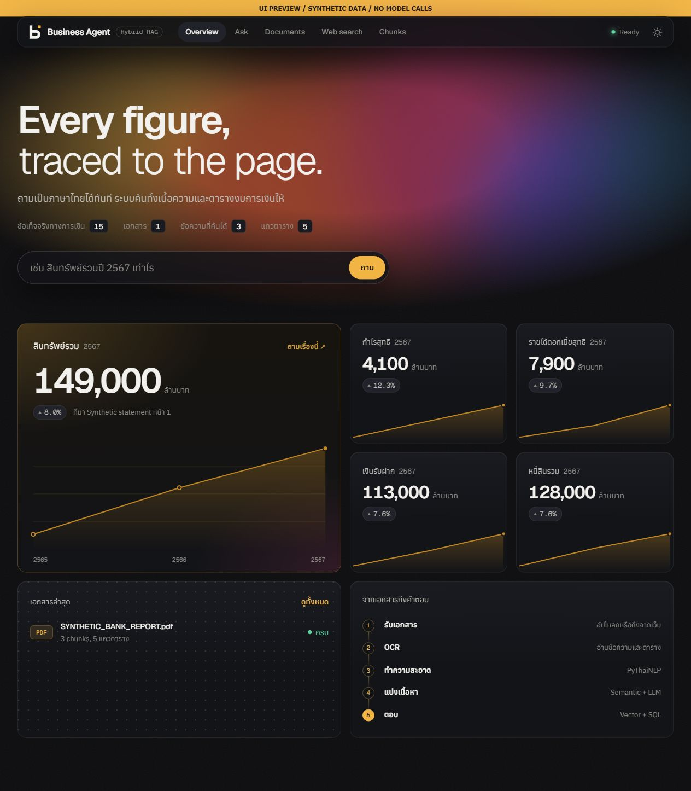
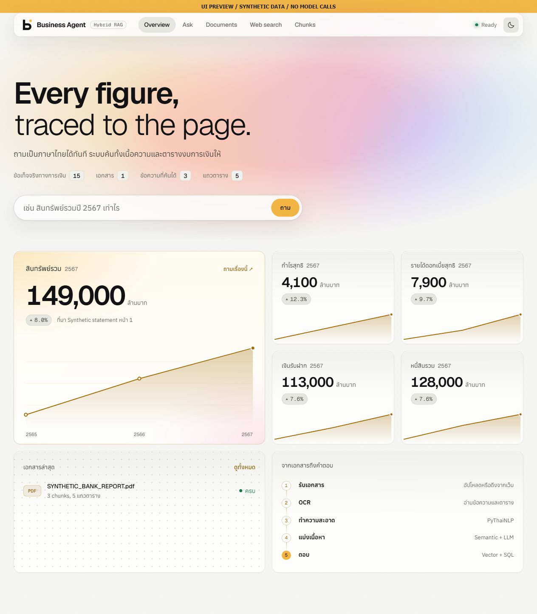
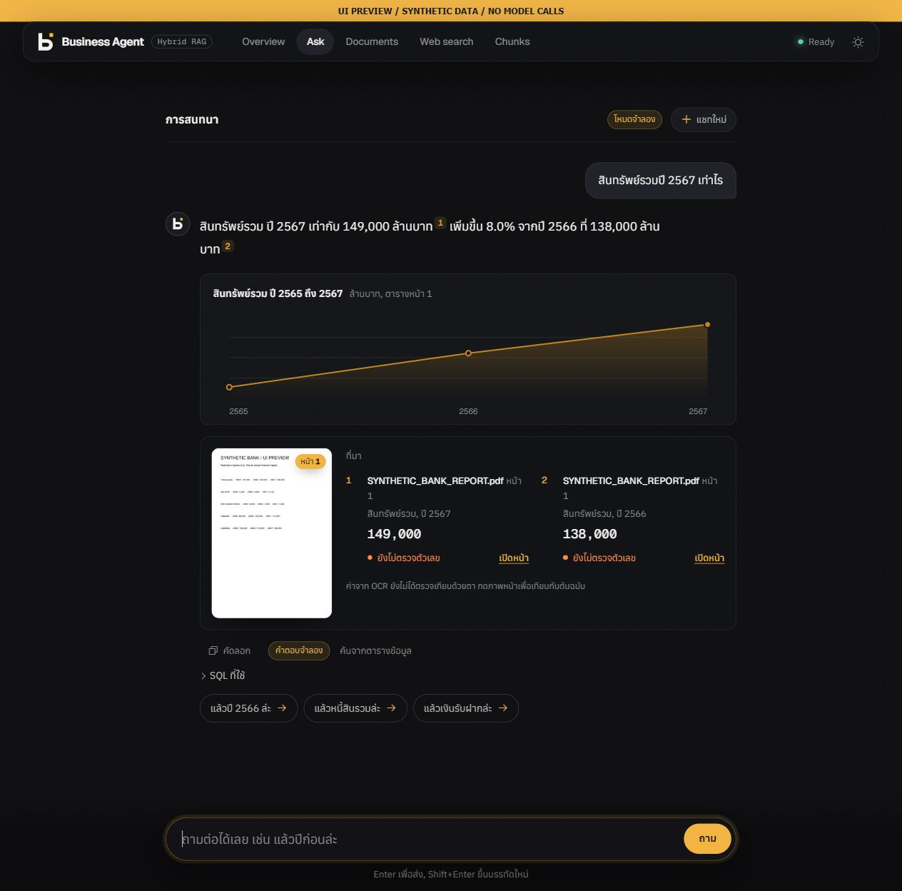

# Business Agent UI integration — 16 October 2026

## Source and credit

The redesigned interface comes from the team's upstream branch
[`auto1-ui`](https://github.com/WachirawitThaneesan/Agentic_RAG_Business-Insight-Analysis/tree/auto1-ui),
at `c0e548ceccf088280da00846f45701af735bea90`.
Four focused commits were cherry-picked with their original authorship, dates,
co-author trailers, and upstream commit references:

| Upstream commit | Change |
| --- | --- |
| `30d83b2` | Overview, conversational Ask, document register, crawl map, chunk seams, dark/light themes |
| `3ef4343` | Business Agent logo, icons, and brand assets |
| `7ee0756` | Rename navigation to Web search |
| `a16e8ed` | Share a PDFium lock between citation images and OCR rendering |

The upstream author is `wachirawit-amity`; the original co-author metadata is
retained. The integration preserves the existing publication backend and
research evidence. It does not import the unrelated newer evaluation results
on upstream `auto1`, or change the original Desktop checkout's branch or files.

## What changed and why

- **Overview:** financial metrics and trend charts can lead directly to a question.
- **Ask:** a conversation shows follow-up questions, source notes, and a PDF image
  viewer beside the answer. The demo switch reads stored warehouse rows or
  chunks without calling a model; every demo answer is labelled.
- **Documents:** a register shows processing status and failed pages.
- **Web search:** the crawl map presents progress as documents are discovered.
- **Chunks:** the seam strip helps inspect changes in meaning between chunks.
- **Theme and branding:** dark and light themes share the new Business Agent mark.
- **PDF rendering:** a shared lock prevents concurrent PDFium calls from
  corrupting the page renderer's process-wide state.

## Reproduce the UI preview

From the repository root, with the project dependencies installed:

```powershell
python scripts/preview_ui.py
```

Open `http://127.0.0.1:5081`. Stop the server with Ctrl+C.
This loopback-only preview serves the real frontend and a small synthetic
DuckDB dataset. A visible banner identifies every screenshot as a UI preview.
The report images are generated sample pages, not real bank documents.
Uploads, deletion, scraping and model calls are unavailable in the preview.
It never opens the project's runtime database, credentials or uploaded reports.
Use the normal FastAPI setup in the README for the actual application.

## Verification

- Existing focused backend suite: **96 passed**.
- New mixed OCR/citation concurrency regression: **1 passed**, with 18 renders
  submitted across six threads using a generated PDF.
- `node --check`: all six frontend JavaScript files passed.
- Browser checks with synthetic data: Overview charts, both themes, Ask answer,
  follow-up year resolution, PDF modal image, document register, selected-document
  chunk visualization, and Web search form.
- Overview and Ask at a 375 px viewport: no document-level horizontal overflow.
- No JavaScript errors observed during these browser checks.

The existing Pydantic class-config deprecation warning remains. These checks
do not rerun paid OCR/LLM services, live scraping, production ingestion, or the
498-question research evaluation. The frozen evaluation on the portfolio keeps
its original date and scope.

## Screenshots — synthetic UI preview

### Overview, dark



### Overview, light



### Ask with source evidence


